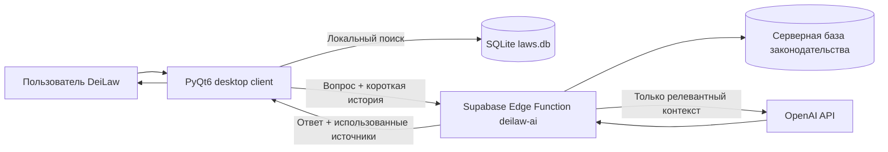

<p align="center">
  
</p>

<h1 align="center">DeiLaw</h1>

<p align="center">
  Помощник по законодательству RMRP: быстрый поиск норм, памятка, калькулятор наказаний, Устав УГИБДД и Cloud AI.
</p>

<p align="center">
  <strong>Текущая версия исходников: 0.3.1</strong> · Windows · Python / PyQt6
</p>

> [!IMPORTANT]
> **Для верификации проекта:** исходный код клиентского приложения находится непосредственно в этом репозитории. Исходный код Cloud AI backend находится в [`supabase/functions/deilaw-ai/index.ts`](supabase/functions/deilaw-ai/index.ts). Контакты разработчика и описание функционала приведены ниже. Секретные серверные ключи в репозиторий не публикуются.

## О проекте

**DeiLaw** — неофициальное desktop-приложение для игроков RMRP, которым нужен быстрый доступ к игровому законодательству во время RP. Приложение объединяет локальную базу законодательства, умный поиск, быстрые оверлеи поверх игры, персональную памятку, калькулятор наказаний, подключаемый Устав УГИБДД и облачного юридического помощника.

Проект не является официальным программным обеспечением RMRP и не представляет администрацию проекта RMRP.

## Основной функционал

| Возможность | Что делает |
|---|---|
| 🔎 **Умный поиск** | Ищет точные статьи (`63 УК`, `63.3 УК`, `9.8 КоАП`) и понимает запросы обычным языком. Для УК/КоАП показывает содержание и распознанное наказание. |
| 📚 **Локальная база законов** | Хранит законодательство локально в SQLite и позволяет работать с ним без постоянной загрузки страниц форума. |
| 🔄 **Обновление законодательства** | Загружает актуальные документы RMRP, обновляет локальную базу и показывает изменения статей между редакциями. |
| 📖 **Просмотр законов** | Позволяет читать нормативные документы по разделам, главам и статьям. |
| 🚓 **Устав УГИБДД** | Подключает Устав из локального DOCX либо поддерживаемой ссылки; после подключения появляется отдельная вкладка. |
| 📌 **Памятка** | Пользовательские столбцы, разделы и карточки часто используемых статей с кратким описанием и наказанием. |
| ⚡ **Quick Search — F7** | Быстрый поиск поверх игры без открытия основного окна. Горячая клавиша настраивается. |
| 🖥 **Quick Memo — F8** | Отдельное окно памятки поверх игры с настройками размера, прозрачности и режима кликов. |
| 🧮 **Калькулятор наказаний** | Складывает штрафы, административный арест и сроки лишения свободы по нескольким статьям. Диапазоны и альтернативные наказания пользователь выбирает вручную. |
| 🚀 **Quick Calculator — F9** | Быстрый оверлей калькулятора, использующий тот же список выбранных статей, что и основное окно. |
| ☁ **DeiLaw Cloud AI** | Принимает RP-ситуацию или юридический вопрос, сервером ищет подходящие нормы и формирует ответ на их основе. Локальные Ollama/Qwen в актуальной версии не требуются. |
| 🔐 **Discord / Гостевой вход** | На старте предлагается вход через Discord (OAuth + PKCE) или гостевая Supabase-сессия. Токены хранятся локально под защитой Windows DPAPI. Для Discord нужна настройка провайдера, см. [инструкцию](docs/DISCORD_AUTH_SETUP.md). |
| 🧾 **История** | Хранит историю поиска, историю изменений законодательства и историю релизов программы. |
| 🐞 **Репорты** | Создание баг-репортов, просмотр статуса, чат с разработчиком, вложения и уведомление о новом ответе. |
| ⭐ **Отзывы** | Публичные отзывы с коротким ID пользователя и ответами разработчика. |
| 💡 **Предложения** | «Предложить идею» и «Мои предложения» со статусами рассмотрения и ответом разработчика. |
| 🎨 **Оформление** | Dark/Light режимы, набор визуальных тем, настройка размеров интерфейса и отдельных Quick-окон, звуки интерфейса. |
| ⬆ **Автообновление** | Проверка GitHub Releases до запуска и во время работы; режимы «Автоматически», «С подтверждением», «Только уведомлять». Установка требует подписанного релиза и установленной Windows-версии. |
| 🛟 **Диагностика и safe mode** | Логи, состояние компонентов, резервные копии пользовательских данных и безопасный запуск после повторных сбоев. |

## Как работает Cloud AI

Актуальная версия использует серверный контур, чтобы секреты OpenAI не хранились в desktop-клиенте.



Клиент отправляет Cloud AI текст текущего вопроса, до шести последних сообщений диалога, режим запроса, идентификатор установки, односторонний хэш идентификатора устройства и версию приложения. Поиск по серверной базе законодательства выполняется на стороне Supabase. Серверные `OPENAI_API_KEY` и служебные Supabase-ключи берутся из переменных окружения Edge Function и **не должны находиться в GitHub**.

## Режимы юридического поиска Cloud AI

Cloud AI различает тип запроса. Для точного запроса статьи система ищет конкретную норму; при квалификации действий гражданина приоритетными статьями ответственности являются УК и КоАП; при вопросах о полномочиях, обязанностях или правовом основании первичными источниками могут быть ПДД, ПК, УПК, ФЗ, уставы и другие профильные документы. В ответ клиенту возвращается список использованных источников для проверки.

## Структура исходного кода

```text
DeiLaw/
├── main.py                       # запуск приложения, startup update, safe mode
├── cloud_auth.py                 # гостевые и Discord JWT-сессии
├── discord_oauth.py              # системный браузер и PKCE callback
├── ui/auth_dialog.py             # выбор входа до запуска главного окна
├── ui/main_window.py             # основной интерфейс и Quick-окна F7/F8/F9
├── database.py                   # SQLite и работа с локальной базой
├── parser.py                     # загрузка законодательства RMRP
├── article_parser.py             # разбор документов и статей
├── update_worker.py              # фоновое обновление законодательства
├── search_lexicon.py             # словарь и умный текстовый поиск
├── gibdd_charter.py              # подключение/разбор Устава УГИБДД
├── community_client.py           # отзывы, репорты, предложения и идентичность клиента
├── ai_worker.py                  # фоновый AI worker
├── ai_core/
│   ├── cloud.py                  # клиент DeiLaw Cloud AI
│   ├── engine.py                 # подготовка/обработка юридического ответа
│   ├── retrieval.py              # поиск и отбор норм
│   ├── grounding.py              # источники и привязка ответа к нормам
│   └── policy.py                 # правила ответа AI
├── updater.py                    # обновление приложения через GitHub Releases
├── user_state.py                 # резервные копии и состояние пользователя
├── sync_laws_to_cloud.py         # ручная синхронизация серверной законки
├── supabase/
│   └── functions/deilaw-ai/
│       └── index.ts              # исходный код Cloud AI Edge Function
├── installer/                    # Inno Setup / ресурсы установщика
├── assets/                       # звуки и ресурсы
├── docs/                         # документация для разработчика и верификации
└── requirements.txt              # Python-зависимости
```

Подробная схема компонентов: [`docs/ARCHITECTURE.md`](docs/ARCHITECTURE.md). Отдельная памятка для проверки проекта: [`docs/VERIFICATION.md`](docs/VERIFICATION.md).

## Запуск из исходников

### Требования

- Windows 10/11;
- Python 3.11+ (разработка проекта ведётся и тестируется на современных версиях Python);
- интернет для обновления законов, Community-функций, Cloud AI и проверки обновлений программы.

### Установка

```bash
git clone https://github.com/DeiZiXX/DeiLaw.git
cd DeiLaw
python -m venv .venv
```

Windows CMD:

```bat
.venv\Scripts\activate
python -m pip install --upgrade pip
pip install -r requirements.txt
python main.py
```

При первом запуске локальная база может отсутствовать или быть пустой — её можно заполнить штатным обновлением законодательства в интерфейсе.

## Сборка Windows

В репозитории оставлены скрипты сборки и Inno Setup-конфигурация:

- `build_app_only.ps1` / `build_app_only.bat` — сборка приложения;
- `build_release.ps1` / `build_release.bat` — подготовка релиза;
- `installer/DeiLaw.iss` — сценарий установщика;
- `DeiLaw.spec` — конфигурация PyInstaller.

Перед публикацией релиза рекомендуется выполнить:

```bash
python scripts/verify_source.py
```

Скрипт проверяет обязательные файлы, синтаксис Python и отсутствие типовых секретов в исходниках.

## Данные и конфиденциальность

Пользовательские настройки, локальная SQLite-база, логи, идентификатор установки, история и резервные копии являются runtime-данными и не должны коммититься в Git. Для этого в репозитории настроен `.gitignore`.

Community-функции используют локально созданный ID установки. На Windows также формируется односторонний salted SHA-256 хэш на основе MachineGuid; исходный MachineGuid клиент по своему коду не отправляет. Подробности: [`PRIVACY.md`](PRIVACY.md).

## Безопасность и секреты

В публичном репозитории **не должны** находиться:

- `OPENAI_API_KEY`;
- Supabase `service_role` / secret key;
- пароли администратора;
- персональные `.env`;
- пользовательские БД, логи, токены и файлы идентичности.

Supabase publishable key, используемый desktop-клиентом, является публичным клиентским ключом и не заменяет серверные политики доступа. Серверные секреты читаются Edge Function из переменных окружения. См. [`SECURITY.md`](SECURITY.md).

## Контакты разработчика

**Разработчик:** DeiZi / GitHub **DeiZiXX**  
**Telegram:** [@DeiZiS](https://t.me/DeiZiS)  
**GitHub:** [github.com/DeiZiXX](https://github.com/DeiZiXX)  
**Ошибки и предложения:** [GitHub Issues](https://github.com/DeiZiXX/DeiLaw/issues)

Для вопросов по верификации проекта можно использовать Telegram либо GitHub Issues.

## Code signing policy / цифровая подпись

Политика подготовки к подписи: [Code signing policy](CODE_SIGNING_POLICY.md).
Проект **пока не одобрен SignPath Foundation и не имеет подписанного релиза**.
Подготовка лицензионных прав: [GPL plan](docs/GPL3_TRANSITION_PLAN.md) и
[license audit](docs/LICENSING_AUDIT_0.3.1.md).

Новый открытый сценарий установщика: `installer/DeiLaw.nsi` (NSIS),
проверяемая Windows-сборка: `.github/workflows/windows-build.yml`.
Нельзя обозначать артефакты этого workflow как подписанные.

## Правовой статус

DeiLaw — независимый пользовательский инструмент. Названия RMRP и связанных игровых организаций используются только для описания совместимости и назначения программы. Проект не заявляет аффилированность с владельцами RMRP.

Исходный код опубликован для прозрачности и проверки. Условия использования исходников указаны в [`LICENSE`](LICENSE).

## Discord: автоматическое восстановление старых отзывов и репортов (0.3.5rc8)

При входе через Discord (в том числе автоматическом входе после перезапуска)
приложение в фоновом режиме выполняет RPC `deilaw_claim_legacy_ownership`.
Сервер проверяет подтверждённый Discord-профиль и сверяет секрет прежней
установки с SHA-256 в старых записях. После успешной проверки старые
репорты, переписка, вложения и отзыв становятся доступны этому Discord-аккаунту.
Гостевой режим не может привязывать старые записи.

**Сохраните папку `data` предыдущей установки DeiLaw**, прежде всего
`community_identity.bin` (на старых версиях — `community_identity.json`).
Если программу распаковали в совершенно новую папку без этих данных,
автоматически доказать владение прежними отзывами и репортами нельзя.
Можно скопировать эти файлы из своей старой папки `data` в новую,
предварительно закрыв DeiLaw. Никогда не пересылайте файл с секретом
другим людям. При утрате файла необходима отдельная процедура восстановления.

Если у Discord-аккаунта уже есть отзыв, старый отзыв **не удаляется** и
не заменяет новый автоматически (предотвращение конфликта уникального отзыва).
Репорты при этом всё равно переносятся. Сообщения и вложения следуют
владельцу репорта. Для переноса требуется применённая серверная миграция
`SUPABASE_LEGACY_DISCORD_AUTO_CLAIM_20261112.sql`; в рабочем Supabase она
уже установлена. Повторно выполнять старые SQL-файлы настройки нельзя.
