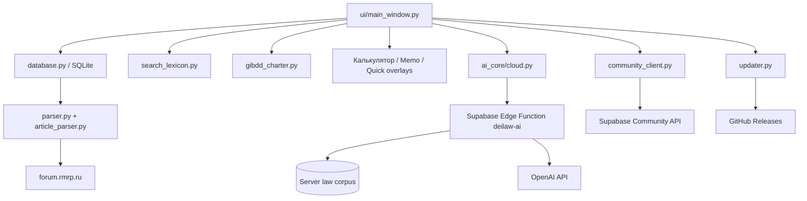

# Архитектура DeiLaw

## Общая схема

DeiLaw состоит из desktop-клиента на Python/PyQt6, локального слоя данных и нескольких опциональных сетевых контуров.

## Desktop client

`main.py` отвечает за старт приложения, логирование, pre-launch update и safe mode. После успешного старта создаётся главное окно из `ui/main_window.py`.

Основной интерфейс объединяет страницы поиска, просмотра законов, Устава, памятки, калькулятора, AI-помощника, обновления, истории релизов, отзывов и настроек. Там же реализованы Quick Search F7, Quick Memo F8 и Quick Calculator F9.

## Локальная база

`database.py` работает с SQLite-базой `data/laws.db`. `parser.py` и `article_parser.py` загружают и разбирают документы законодательства. `update_worker.py` выполняет обновление в фоне, чтобы UI не блокировался.

Runtime-база не хранится в Git и создаётся/обновляется на стороне пользователя.

## Умный поиск

`search_lexicon.py` нормализует формулировки, поддерживает алиасы законов, ключевые фразы и предложения при вводе. Один и тот же механизм используется в основном поиске, Quick Search, памятке и калькуляторе.

## Устав УГИБДД

`gibdd_charter.py` работает с DOCX и поддерживаемыми внешними источниками, создавая локальное представление глав/статей. Вкладка Устава появляется только когда источник подключён и доступен.

## Cloud AI

Клиент: `ai_core/cloud.py`.

Backend: `supabase/functions/deilaw-ai/index.ts`.

Desktop-клиент не обращается к OpenAI напрямую и не хранит `OPENAI_API_KEY`. Он отправляет пользовательский вопрос и короткую историю в Edge Function. Backend выполняет поиск по серверной законке, формирует ограниченный grounding context, обращается к OpenAI и возвращает ответ вместе со списком норм-источников.

`ai_core/retrieval.py`, `engine.py`, `grounding.py` и `policy.py` содержат правила классификации запросов, подготовки источников, контроля юридических режимов и отображения доказательной базы.

## Community

`community_client.py` реализует отзывы, репорты, чат, предложения и анонимную идентичность установки. Постоянный installation ID создаётся локально. На Windows используется salted SHA-256 от локального MachineGuid для стабильного device ID; raw MachineGuid не включается в запросы.

## Обновления приложения

`updater.py` использует официальный GitHub repository `DeiZiXX/DeiLaw` и GitHub Releases. Поддерживаются stable и beta каналы, проверка версии до запуска UI, скачивание и запуск update helper.

## Runtime-данные

В каталоге `data/` могут появляться SQLite-база, настройки, история, логи, identity-файлы и резервные копии. Эти данные исключены из репозитория через `.gitignore`.

## Секреты

Backend-секреты должны задаваться только через environment/secrets Supabase. В исходниках допускается только public/publishable клиентская конфигурация. См. `SECURITY.md`.
